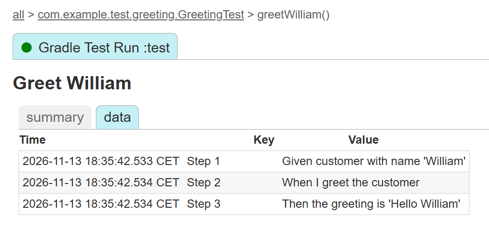

[](https://central.sonatype.com/artifact/io.github.gadnex/fluentbdd)

FluentBDD provides JUnit Jupiter and Spring integration for reporting BDD-style test steps. It requires Java 17 or newer, Spring Framework 7, and JUnit Jupiter 6.

## Build and install locally

Run `./gradlew build publishToMavenLocal` (on Windows, `gradlew.bat build publishToMavenLocal`). This publishes `io.github.gadnex:fluentbdd` (version derived from Git tags), including its dependency metadata, sources and Javadoc, to the local Maven repository. This does not publish to a remote repository; configure one before sharing the artifact with other machines.

## Use in a Gradle project

```kotlin
repositories {
    mavenLocal() // for the locally published snapshot
    mavenCentral()
}

dependencies {
    // Check the Maven Central badge above for the latest version
    testImplementation("io.github.gadnex:fluentbdd:1.0.0")

    testImplementation("org.springframework:spring-test:7.0.10")
    testRuntimeOnly("org.junit.jupiter:junit-jupiter-engine:6.1.3")
    testRuntimeOnly("org.junit.platform:junit-platform-launcher")
}

tasks.test { useJUnitPlatform() }
// Not needed for Spring Boot projects; Spring Boot sets this automatically
tasks.compileTestJava { options.compilerArgs.add("-parameters") }
```

## Use in a Maven project

After publishing locally, add the following test dependencies (and configure a current Maven Surefire plugin for JUnit Jupiter):

```xml
<dependency>
  <groupId>io.github.gadnex</groupId>
  <artifactId>fluentbdd</artifactId>
  <!-- Check the Maven Central badge above for the latest version -->
  <version>1.0.0</version>
  <scope>test</scope>
</dependency>
<dependency>
  <groupId>org.springframework</groupId>
  <artifactId>spring-test</artifactId>
  <version>7.0.10</version>
  <scope>test</scope>
</dependency>
<dependency>
  <groupId>org.junit.jupiter</groupId>
  <artifactId>junit-jupiter-engine</artifactId>
  <version>6.1.3</version>
  <scope>test</scope>
</dependency>
```

Enable parameter names in the Maven Compiler Plugin using `<parameters>true</parameters>`; set the Java release to at least 17. Align dependency versions with your application's Spring and JUnit versions where appropriate.

## Writing a test

Register a driver as a Spring bean, annotate the test with `@BddDriver`, and inject the driver. For a plain Spring test, include the test class in the context configuration so Spring processes the annotation's import:

```java
@SpringJUnitConfig({GreetingTest.class, GreetingDriver.class})
@BddDriver(GreetingDriver.class)
@DisplayName("Greet a customer")
class GreetingTest {

  @Autowired private GreetingDriver customer;

  @Test
  @DisplayName("Greet William")
  void greetWilliam() {
    customer
        .givenCustomerName("William")
        .whenIGreetTheCustomer()
        .thenTheGreetingIs("Hello William");
  }
}
```

The service under test is a plain Spring bean:

```java
@Service
class GreetingService {

  String greet(String name) {
    return "Hello " + name;
  }
}
```

The driver extends `BddTestDriver` and uses `@Step` annotations to report each step:

```java
@Component
class GreetingDriver extends BddTestDriver {

  private final GreetingService greetingService;
  private String name;
  private String greeting;

  GreetingDriver(GreetingService greetingService) {
    this.greetingService = greetingService;
  }

  @Override
  protected void clearState() {
    name = null;
    greeting = null;
  }

  @Step("Given customer with name '{name}'")
  GreetingDriver givenCustomerName(String name) {
    this.name = name;
    return this;
  }

  @Step("When I greet the customer")
  GreetingDriver whenIGreetTheCustomer() {
    greeting = greetingService.greet(name);
    return this;
  }

  @Step("Then the greeting is '{greeting}'")
  void thenTheGreetingIs(String greeting) {
    assertThat(this.greeting).isEqualTo(greeting);
  }
}
```

The test report shows each BDD step in the **data** tab:



Compile the sources containing `@Step` methods with `-parameters` so placeholders match parameter names. Call steps through the injected Spring proxy; self-invocation, private methods and final methods are not intercepted. Drivers typically contain mutable scenario state, so tests sharing a driver bean must not run concurrently.